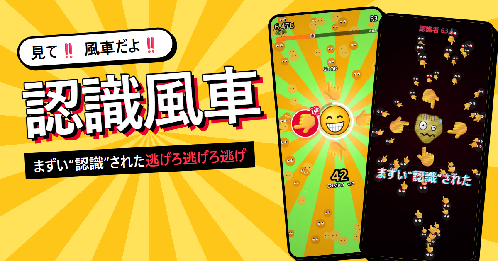

<div align="center">

# 認識風車

**見て‼️風車だよ‼️ まずい“認識”された逃げろ逃げろ逃げ**

<a href="https://sabopura.github.io/ninshiki-fusha/"></a>

スマホ・PC のブラウザですぐ遊べます（インストール不要・🔊音ありがおすすめ）

<a href="https://sabopura.github.io/ninshiki-fusha/"></a>

</div>

## どんなゲーム？

```
　　👆
　👈😁👉
　　👇
```

「見て‼️風車だよ‼️」の絵文字ネタをゲームにしました。
調子に乗って風車を回すほど周りに“認識”されていき、認識されたら全力で逃げます。

## 遊び方

ゲームは3つのパートでできています。

### ① 風車 ― 光った指の方へフリック

- 😁 のまわりで光った指の方向へ、すばやくフリックして風車を回します
- 連続で成功するとコンボが伸び、**FEVER** 中はスコアが2倍になります
- 回すほど「注目度」が上がり、見ている人（認識者）が増えていきます

### ② 罠 ― 惑わされずに回す

ラウンドが進むと罠が混ざります。

| 罠 | やること |
|---|---|
| 🫵 | 触らずに待つ |
| 赤い指 | 逆の方向へフリック |
| 番号付きの指 | 1→2 の順にフリック |

### ③ 認識 ― リズムに乗って逃げろ

注目度が限界に達すると“認識”され、逃走パートが始まります。リズムに合わせて操作し、逃げ切りを目指します。

| 合図 | 操作 |
|---|---|
| 🫵 が迫ってくる | その方向へ **スワイプ** で払う |
| 📸 輪が重なる | その瞬間に **タップ** |
| 👁️ 目が開いている | 閉じるまで **長押し** で隠れる |

失敗すると「認識度」が上がり、満タンになると顔を記録されてゲームオーバーです。

## やりこみ要素

- **称号**：認識者の数に応じて「一般通過風車」→「目立ちたがり風車」→「要注意風車」→「指名手配風車」→ …… と上がっていきます
- **スキン**：条件を満たすと新しい見た目が解放されます
- **今日の風車**：日替わりの記録。結果は 𝕏 にポストしたり、コピーして共有したりできます

## メモ

- 個人で作ったものです。手元の環境でのみ動作を確認しています
- 絵文字は端末の絵文字で表示します。対応していない端末では一部に [Twemoji](https://github.com/twitter/twemoji)（© Twitter, Inc. and other contributors, CC-BY 4.0）を使用しています
